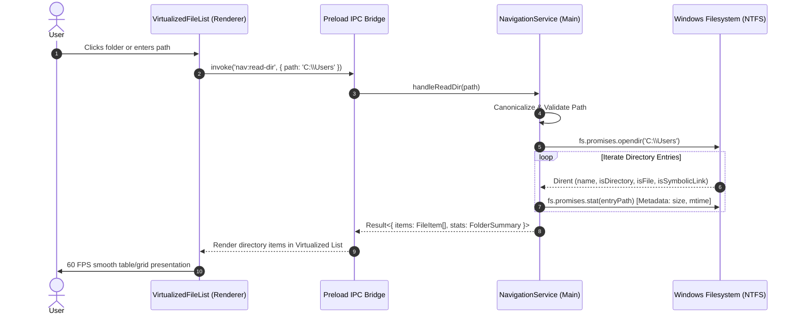
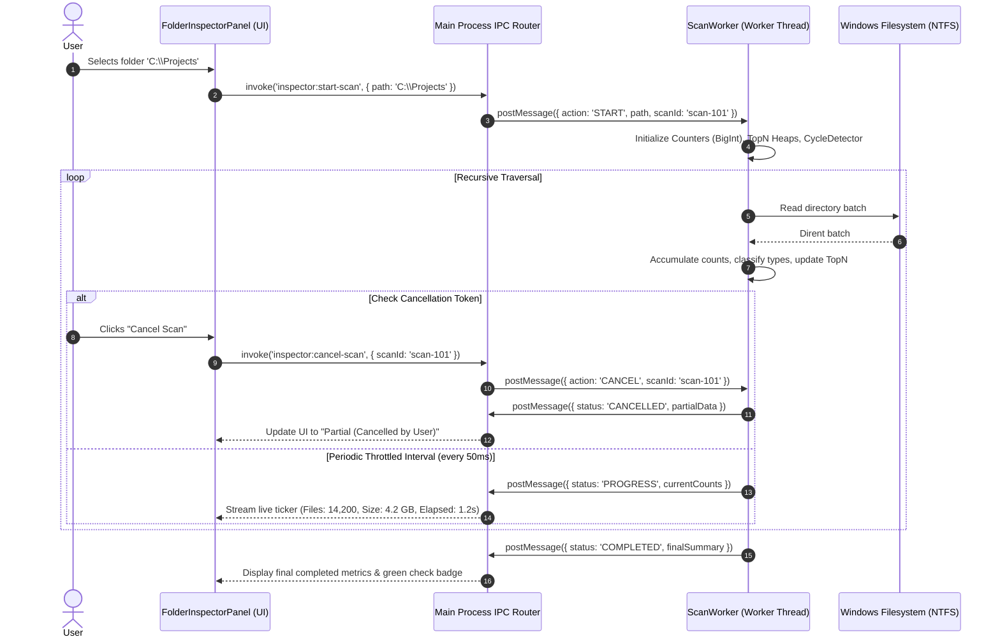
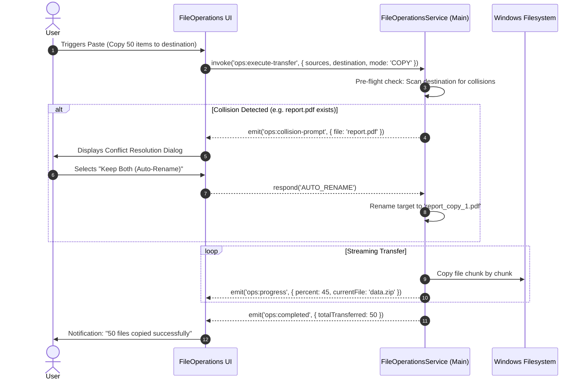

# System Architecture & Repository Map
## Advanced File Explorer for Windows

**Document Version:** 1.0.0  
**Status:** Approved for Implementation Planning  
**Target Platform:** Windows 10 / Windows 11 (x64, ARM64)  
**Reference Document:** `ADVANCED_FILE_EXPLORER_MASTER_BLUEPRINT.md`  
**Prerequisite Document:** `docs/PRD.md`

---

## 1. Factual Audit of the Current Workspace

### 1.1 Workspace Directory Structure
Inspection of the project root reveals the following structure:

```
advanced-file-explorer/
├── ADVANCED_FILE_EXPLORER_MASTER_BLUEPRINT.md  (Project blueprint and architectural specification)
├── docs/                                        (Core system documentation)
│   ├── PRD.md
│   ├── ARCHITECTURE.md
│   ├── UX_UI_SPEC.md
│   ├── IMPLEMENTATION_PLAN.md
│   └── TESTING_AND_ACCEPTANCE.md
├── src/                                         (Application source code)
└── tests/                                       (Automated unit and integration test suites)
```

### 1.2 Inspection of Existing Repository Components
1. **Workspace Root:**
   - The root workspace is **not a Git repository** (`fatal: not a git repository`).
   - Prior to this audit, no file explorer implementation, source files, or build scripts existed in the root.
2. **The `rea` Subdirectory:**
   - Cloned from `https://github.com/morluto/rea.git` (commit `23f984b1a`, version `6.7.0`).
   - Package name: `rea-agents`, MCP name: `io.github.morluto/rea`.
   - **Audit finding:** `rea` is an open-source MCP server and CLI for reverse-engineering native binaries, Web/Electron applications, and runtime tracing using Hopper, Ghidra, and IDA. It does **not** contain file explorer UI components, tabbed browsing, dual-pane layouts, or folder storage inspection widgets. It was cloned into the directory immediately prior to this engagement and remains unmodified on branch `main`.
   - **Baseline Rule:** `rea` is preserved untouched per Rule 1 ("Do not destroy existing work").
3. **Detected Host Toolchains & Runtimes:**
   - **Node.js:** `v24.15.0` (Active LTS runtime, supporting ES modules, `worker_threads`, modern Web APIs)
   - **npm:** `11.16.0`
   - **.NET SDK:** `10.0.300` (`dotnet` CLI available)
   - **Rust / Cargo:** `1.99.0` (`cargo` CLI available)
   - **Host OS:** Microsoft Windows 11 Desktop (PowerShell 7 / pwsh environment)

---

## 2. Technology Stack & Framework Selection

To build a professional-grade Windows desktop file manager that fulfills all requirements in `docs/PRD.md` (fast virtualized list rendering, customizable Fluent design system, high-concurrency non-blocking background scanning, and direct Windows filesystem integration), the application architecture is structured as a **Modern Desktop Application**:

| Architectural Tier | Technology Choice | Rationale & Justification |
| :--- | :--- | :--- |
| **Desktop Shell & Container** | **Electron 34+ / Node.js 24 LTS** | Provides native Windows desktop windowing, system menu hooks, clipboard access, shell integration, and direct local filesystem APIs without browser sandbox constraints. |
| **Frontend Framework & UI** | **Vanilla CSS + Modern TypeScript (Vite bundler)** | Maximum performance, zero framework overhead, complete control over DOM layout, CSS Grid/Flexbox, Fluent-inspired glassmorphism, dynamic theme switches, and virtual scrolling. |
| **Background Scanning Engine** | **Node.js `worker_threads`** | Dedicated OS-level background threads for recursive folder traversal, checksums, and metadata aggregation, completely isolating heavy I/O from the 60 FPS UI renderer. |
| **Windows Shell Integration** | **Win32 API via Node Native Addon / `win32-api` / PowerShell bridge** | Native Windows Recycle Bin integration (`IFileOperation`), physical disk cluster allocation (`GetCompressedFileSizeW`), file icons, and volume drive enumeration (`GetLogicalDriveStringsW`). |
| **State Management** | **Lightweight Reactive Store (Proxy/Signals Pattern)** | Zero-dependency, predictable unidirectional state flow for active path, selection model, tabs, dual-pane synchronization, and background task progress. |
| **Test & Build Tooling** | **Vitest (Unit/Integration) + Playwright (E2E) + Electron Builder** | Sub-second test execution, comprehensive filesystem mocks, and automated Windows `.exe` / `.msix` installer packaging. |

---

## 3. High-Level System Architecture

The architecture enforces strict separation of concerns across four primary process and architectural boundaries:

```mermaid
graph TB
    subgraph UI_Layer [Presentation Layer (Renderer Process)]
        Header[Header & Breadcrumb Bar]
        NavSidebar[Drives & Quick Access Sidebar]
        FileList[Virtualized File List / Grid / Details]
        DualPaneMgr[Tab & Dual-Pane Coordinator]
        InspectorUI[Folder Inspector Panel]
        TaskBar[Status Bar & Task Progress Drawer]
        Store[Reactive UI State Store]
    end

    subgraph IPC_Bridge [Inter-Process Communication Bridge]
        ContextBridge[Electron contextBridge / Preload API]
        IPCEvents[Typed IPC Channels (Throttled Streams)]
    end

    subgraph App_Core [Application Services (Main Process)]
        NavService[Navigation Service]
        FileOpsService[Safe File Operations Manager]
        DriveService[Drive & Volume Service]
        WatcherService[Filesystem Watcher Manager]
        RecycleBinService[Windows Shell Recycle Bin Adapter]
        WorkerPool[Scan Worker Pool Manager]
    end

    subgraph Worker_Engine [Background Scanning Engine (Worker Thread)]
        ScanWorker[Recursive Directory Scanner]
        Aggregator[Count & Size Aggregation Engine]
        TypeClassifier[File-Type Categorization]
        TopNTracker[Top-5 Largest Files & Folders Heap]
        CycleDetector[Symlink / Reparse Point Cycle Detector]
    end

    subgraph OS_Filesystem [Windows Operating System & Filesystem]
        NTFS[NTFS / ReFS / FAT32 Filesystem]
        Win32Shell[Windows Shell32 / IFileOperation API]
    end

    Header --> Store
    NavSidebar --> Store
    FileList --> Store
    DualPaneMgr --> Store
    InspectorUI --> Store
    Store <--> ContextBridge
    ContextBridge <--> IPCEvents
    IPCEvents <--> NavService
    IPCEvents <--> FileOpsService
    IPCEvents <--> DriveService
    IPCEvents <--> WorkerPool

    FileOpsService --> Win32Shell
    FileOpsService --> NTFS
    DriveService --> Win32Shell
    WatcherService --> NTFS
    WorkerPool --> ScanWorker

    ScanWorker --> Aggregator
    ScanWorker --> TypeClassifier
    ScanWorker --> TopNTracker
    ScanWorker --> CycleDetector
    ScanWorker --> NTFS
```

---

## 4. Subsystem Responsibilities & Architectural Boundaries

### 4.1 Presentation Layer (Renderer Process)
- **Role:** Pure presentation, user input handling, and 60 FPS animation.
- **Constraints:** Zero synchronous filesystem calls (`fs.*Sync` strictly prohibited). All interactions dispatch asynchronous IPC requests to the Main Process.
- **Components:**
  - `BreadcrumbBar`: Renders path tokens, handles ancestor clicking, toggles into direct editable text input upon user click.
  - `NavigationSidebar`: Enumerates drive letter buttons with capacity gauges; displays standard user folders (Desktop, Documents, Downloads, etc.).
  - `VirtualizedFileList`: Renders items currently visible within the viewport (using an offset window of DOM nodes). Enables smooth scrolling even with 50,000+ items.
  - `FolderInspectorPanel`: Displays live statistics, progress ticker, top-N items, file-type distribution bar, and explicit cancellation triggers.
  - `TaskDrawer`: Slides up from the status bar to show active background operations (copy, move, deep scan) with individual cancel buttons.

### 4.2 Application Services Layer (Main Process)
- **Role:** Coordinates application lifecycle, window management, system IPC routing, and native OS integrations.
- **Components:**
  - `NavigationService`: Resolves and validates requested paths, canonicalizes Windows path strings (e.g. converting `C:/test` to `C:\test`, handling `\\?\` long paths), and executes asynchronous directory listings.
  - `FileOperationsService`: Implements safe Copy, Move, Rename, and Delete operations. Computes conflict checks before writing, handles collision resolution, and manages transfer streams.
  - `RecycleBinService`: Interacts with the native Windows Shell API (`SHFileOperationW` / `IFileOperation`) to safely send deleted files to the Windows Recycle Bin rather than executing irreversible unlinks.
  - `WatcherService`: Manages `fs.watch` / ReadDirectoryChangesW handles for the currently viewed directory and inspected folder tree, emitting invalidation events when files are added, modified, or removed.

### 4.3 Background Scanning Engine (Worker Thread)
- **Role:** Executes high-speed, non-blocking recursive traversal of directory trees without loading hundreds of thousands of full file records into memory.
- **Design Pattern:** Streaming accumulator with cooperative cancellation tokens (`AbortSignal`).
- **Internal Modules:**
  - `RecursiveScanner`: Performs depth-first or breadth-first directory traversal using asynchronous readdir handles with file-type flags (`withFileTypes: true`).
  - `CycleDetector`: Tracks visited NTFS unique identifiers (Volume Serial Number + File ID) to instantly identify and halt traversal loops caused by directory junctions or symbolic links.
  - `Aggregator`: Accumulates atomic counters:
    - `totalFiles`: Total count of descendant regular files.
    - `totalFolders`: Total count of descendant subdirectories.
    - `totalBytes`: Combined logical file size in bytes (using `BigInt` to prevent integer overflow on multi-terabyte drives).
    - `emptyFolders`: Count of directories containing 0 files and 0 subdirectories.
  - `TopNTracker`: Maintains two fixed-capacity min-heaps (capacity 5):
    - Top 5 largest individual files (`{ path, sizeBytes }`).
    - Top 5 largest direct child subfolders (`{ path, sizeBytes }`).
  - `TypeClassifier`: Inspects file extensions and categorizes byte counts into fixed categories: `Documents`, `Media`, `Archives`, `Code`, `Executables`, `Other`.
  - `ThrottledProgressPublisher`: Emits batched progress snapshots to the parent process at a controlled cadence (every 50 ms) to eliminate IPC bottlenecking.

---

## 5. Main Data Flows

### 5.1 Directory Browsing Data Flow



### 5.2 Recursive Folder Inspector Scan with Progressive Updates & Cancellation



### 5.3 Safe File Operations (Copy / Move with Collision Detection)



---

## 6. Threading, Concurrency & Memory Management

### 6.1 Multi-Thread Model
- **Thread 1: UI Renderer Thread:** Dedicated strictly to HTML/CSS layout, virtualized list rendering, animation transforms, and user event handling. Under zero circumstances is heavy computation or disk I/O performed here.
- **Thread 2: Main Process Event Loop:** Orchestrates native window lifecycle, handles IPC messaging, queries Windows system APIs, and maintains top-level state.
- **Thread 3+: Background Scan & Worker Pool:** Spawned via Node.js `worker_threads` for recursive directory enumeration, checksumming, and file transfers.
  - Number of concurrent scan workers is capped at `Math.max(1, os.cpus().length - 1)` to prevent disk thrashing and CPU starvation.
  - Scan workers run at low thread priority on Windows (`THREAD_PRIORITY_BELOW_NORMAL`) to guarantee foreground desktop responsiveness.

### 6.2 IPC Throttling & Message Backpressure
When traversing a directory with 200,000 files, a worker could generate 200,000 progress events in a few seconds. If sent raw over IPC, this would overwhelm the V8 serialization bridge and freeze the UI.
- **Mitigation:** The `ThrottledProgressPublisher` buffers file counts and byte additions, flushing to the main process strictly on a 50 ms timer (20 Hz tick rate) or when a major milestone occurs (e.g. scan completion or error).

### 6.3 Memory Footprint Bounds
- Storing full path strings for 1,000,000 files in memory requires ~200 MB of heap.
- **Mitigation:** The `RecursiveScanner` is an **aggregating stream**. As it visits files, it immediately updates scalar counters (`BigInt` size, integer counts, extension category buckets) and updates the top-5 bounded min-heaps. The individual file path string is immediately dereferenced and garbage collected. Only the top-5 largest files retain their path strings.

---

## 7. Windows Filesystem Specifics & Edge Cases

### 7.1 Symbolic Links, Junctions & Loop Detection
- **Reparse Points on Windows:** Directories can be NTFS Junction Points (`IO_REPARSE_TAG_MOUNT_POINT`), Symbolic Links (`IO_REPARSE_TAG_SYMLINK`), or Volume Mount Points.
- **Cycle Prevention:**
  1. Default policy: **Do NOT traverse directory junctions or symlinks** recursively. The link itself is recorded with its immediate attribute, and its subfolder contents are not enumerated.
  2. Safe traversal mode: When enabled, the scanner queries the Win32 `BY_HANDLE_FILE_INFORMATION` structure via native call to obtain `dwVolumeSerialNumber` and the 64-bit file index (`nFileIndexHigh` / `nFileIndexLow`). Visited directory identities are stored in a `Set<string>`. If an identity is revisited, traversal aborts immediately for that subtree, logging a cycle warning.

### 7.2 Logical Size vs. Physical Disk Allocation
- **Logical Size:** The actual count of bytes in the file stream (`stats.size`).
- **Physical Allocation Size:** NTFS allocates storage in clusters (typically 4,096 bytes per cluster). A 10-byte file occupies 4,096 bytes of physical disk space. Sparse files and compressed files may occupy fewer bytes on disk than their logical stream size.
- **Implementation:** The scanner uses `GetCompressedFileSizeW` to obtain the true on-disk cluster allocation. Both numbers are surfaced in the Folder Inspector:
  - *Logical Size:* 14.2 MB (14,920,440 bytes)
  - *Size on Disk:* 16.8 MB (due to 4 KB cluster allocation boundaries)

### 7.3 Permissions, Locked Files & Inaccessible Directories
- **Fault-Tolerant Traversal:** In Windows, system directories (e.g. `C:\System Volume Information`, `C:\ProgramData\Microsoft\Crypto`) return `EACCES` or `ERROR_ACCESS_DENIED`.
- **Handling Invariant:** An unreadable directory must NEVER terminate the scan. The scanner catches the exception, increments `inaccessibleFolderCount`, appends `{ path, errorCode, timestamp }` to the scan's warning log, and continues traversing remaining sibling directories.
- **Honest UI State:** The final state is rendered as **"Completed with 4 Inaccessible Folders"** with an amber indicator, clearly stating that totals exclude those restricted folders.

### 7.4 Filesystem Changes During Scan & Cache Invalidation
- If files are added or deleted in an already scanned directory, the Folder Inspector's in-memory LRU cache marks the record as **Stale**.
- A small badge appears: `[Stale - Files modified since last scan]`, offering an instant **"Refresh"** button.

---

## 8. Error Propagation, Logging & Diagnostics

### 8.1 Tagged Error Hierarchy
All subsystem failures are modeled using strongly-typed error objects:

```typescript
export type ExplorerError =
  | { code: 'E_PATH_NOT_FOUND'; path: string; message: string }
  | { code: 'E_ACCESS_DENIED'; path: string; win32Error: number; message: string }
  | { code: 'E_SCAN_CANCELLED'; scanId: string; partialStats: FolderStats }
  | { code: 'E_FILE_COLLISION'; source: string; target: string }
  | { code: 'E_DISK_FULL'; path: string; bytesRequired: bigint }
  | { code: 'E_CYCLE_DETECTED'; path: string; targetPath: string };
```

### 8.2 Structured Diagnostics
- The application logs errors and diagnostics locally to `%APPDATA%\AdvancedFileExplorer\logs\app.log`.
- Log rotation keeps the last 5 sessions, capped at 10 MB per file.
- Sensitive information (e.g., credentials or private document contents) is strictly excluded from logs. Only paths, error codes, and operational durations are recorded.

---

## 9. Security, Safety & Privacy

1. **Local-Only Processing:** Zero outbound network calls. All file metadata, paths, counts, and search indices remain 100% on the local machine.
2. **Safe Deletion Guarantee:** Normal delete invokes the Windows Recycle Bin shell integration (`FO_DELETE` with `FOF_ALLOWUNDO`). Permanent delete requires explicit confirmation and cannot be triggered by an accidental single keypress.
3. **Path Canonicalization:** All path inputs are validated against null-byte injection (`\0`), control characters, and normalized using `path.win32.normalize` to eliminate unauthorized directory traversal.

---

## 10. Architectural Decisions, Proposals & Open Questions

| ID | Category | Status | Summary of Architectural Decision |
| :--- | :--- | :--- | :--- |
| **AD-001** | Stack Selection | **Decided** | Built as a modern desktop application utilizing Node.js 24 LTS, modern TypeScript, Vanilla CSS design system, and isolated `worker_threads` for filesystem scanning. |
| **AD-002** | Scan Concurrency | **Decided** | Multi-threaded worker pool; scans run on background worker threads at below-normal OS priority with cooperative `AbortSignal` cancellation. |
| **AD-003** | Windows Recycle Bin | **Decided** | Integrate directly with Windows Shell `IFileOperation` to route file deletions to the Recycle Bin with undo capability. |
| **AD-004** | Symlink Traversal | **Decided** | Reparse points and directory junctions are not traversed recursively by default to guarantee cycle prevention; links are recorded as distinct entities. |
| **AQ-001** | Native Node Addon vs. PowerShell Bridge | **Proposed** | Evaluate building a lightweight C++ Node-API native addon (`explorer-native.node`) for Win32 `IFileOperation` and `GetCompressedFileSizeW` versus an out-of-process PowerShell host bridge. *Recommendation: Node-API addon for sub-millisecond call overhead.* |
| **AQ-002** | Virtual File List Technology | **Decided** | Custom zero-dependency DOM virtualization sliding window to achieve 60 FPS without external heavy grid dependencies. |
