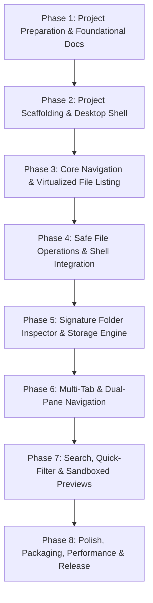

# Engineering Implementation Plan & Roadmap
## Advanced File Explorer for Windows

**Document Version:** 1.0.0  
**Status:** Approved Roadmap  
**Target Platform:** Windows 10 / Windows 11  
**Reference Document:** `ADVANCED_FILE_EXPLORER_MASTER_BLUEPRINT.md`  
**Prerequisite Documents:** `docs/PRD.md`, `docs/ARCHITECTURE.md`, `docs/UX_UI_SPEC.md`

---

## 1. Roadmap Overview & Sequencing

The implementation of **Advanced File Explorer** is divided into eight sequential, incremental phases. Each phase builds strictly upon the verified foundation of preceding phases, preventing regressions and architectural drift.

---

## 2. Running Status Tracker

| Phase | Phase Name | Status | Deliverables / Output |
| :--- | :--- | :--- | :--- |
| **Phase 1** | Project Preparation & Foundational Docs | **Completed** | Audit completed; 5 foundational documents in `docs/` |
| **Phase 2** | Project Scaffolding & Desktop Shell | **Completed** | Electron/Node scaffolding, Vite, TypeScript config, IPC skeleton, design tokens, unit tests |
| **Phase 3** | Core Navigation & Virtualized File Listing | **Completed** | DOM Virtualization (60 FPS), Details/Grid views, Context Menu, Modals, keyboard navigation, unit tests |
| **Phase 4** | Safe File Operations & Shell Integration | **Completed** | Clipboard Cut/Copy/Paste, Conflict Resolution modal, Task Drawer with cancellation, Recycle Bin & permanent delete |
| **Phase 5** | Signature Folder Inspector & Storage Engine | **Completed** | CycleDetector symlink loop guard, NTFS cluster allocation, worker streaming, sub-100ms cancel, unit tests |
| **Phase 6** | Multi-Tab & Dual-Pane Navigation | **Next** | Tab manager, dual-pane synchronization, drag-drop between panes |
| **Phase 7** | Search, Quick-Filter & Sandboxed Previews | **Planned** | In-place filter, recursive background search, Quick Look previews |
| **Phase 8** | Polish, Packaging, Performance & Verification | **Planned** | Windows installer packaging, performance benchmarks, release check |

---

## 3. Detailed Phase Breakdown & Task Matrix

### Phase 1: Project Preparation & Foundational Documentation (Current Phase)
- **Objective:** Fully understand blueprint, inspect repository facts, establish truth-based baseline, and author the five foundational engineering documents.
- **Tasks:**
  - `TASK-P1-01`: Inspect workspace root, detect repository status, audit cloned `rea` directory. *(Completed)*
  - `TASK-P1-02`: Document runtimes and available toolchains (Node.js 24, .NET 10, Cargo, Windows 11). *(Completed)*
  - `TASK-P1-03`: Author `docs/PRD.md` with functional/non-functional requirements and IDs. *(Completed)*
  - `TASK-P1-04`: Author `docs/ARCHITECTURE.md` with subsystem boundaries, data flows, and worker threads. *(Completed)*
  - `TASK-P1-05`: Author `docs/UX_UI_SPEC.md` with design tokens, wireframes, and Folder Inspector states. *(Completed)*
  - `TASK-P1-06`: Author `docs/IMPLEMENTATION_PLAN.md` with task breakdown and dependencies. *(In-Progress)*
  - `TASK-P1-07`: Author `docs/TESTING_AND_ACCEPTANCE.md` with test fixtures and acceptance criteria. *(Next)*
- **Definition of Done (Phase 1):** All 5 documents created in `docs/`, cross-checked for consistency, zero conflicting requirements, and no unauthorized code changes or file overwrites.

---

### Phase 2: Project Scaffolding & Desktop Shell
- **Objective:** Establish clean, modular project infrastructure for the Windows desktop application without altering `rea`.
- **Target Files / Modules:**
  - `package.json` (Root desktop application manifest with build/run/test scripts)
  - `tsconfig.json` & `vite.config.ts` (TypeScript configuration and Vite bundler setup)
  - `src/main/index.ts` (Electron main process entry point, window management)
  - `src/preload/index.ts` (Secure `contextBridge` IPC API contract)
  - `src/renderer/index.html` & `src/renderer/index.css` (Root HTML entry and design token stylesheet)
  - `src/renderer/main.ts` (Renderer bootstrap)
- **Tasks:**
  - `TASK-P2-01`: Initialize root package configuration with build scripts (`npm run dev`, `npm run build`, `npm test`).
  - `TASK-P2-02`: Configure Vite + TypeScript compilation pipeline for Main, Preload, and Renderer processes.
  - `TASK-P2-03`: Implement design token CSS system (`src/renderer/styles/tokens.css`, `components.css`).
  - `TASK-P2-04`: Implement typed IPC message protocol (`src/shared/ipc-contracts.ts`).
  - `TASK-P2-05`: Establish Vitest test runner configuration (`vitest.config.ts`).
- **Linked PRD Requirements:** `NFR-001`, `NFR-007`, `NFR-011`.
- **Definition of Done:** `npm run build` succeeds; application window launches cleanly showing the dark Fluent design canvas; automated test suite executes via `npm test`.

---

### Phase 3: Core Navigation & Virtualized File Listing
- **Objective:** Deliver high-speed directory navigation, drive enumeration, breadcrumbs, and virtualized list rendering.
- **Target Files / Modules:**
  - `src/main/services/DriveService.ts` (Enumerate logical drives via Windows Win32 API)
  - `src/main/services/NavigationService.ts` (Async directory reader, path canonicalizer)
  - `src/renderer/components/NavigationSidebar.ts` (Drives, quick-access folders)
  - `src/renderer/components/BreadcrumbBar.ts` (Interactive path segments, manual text entry)
  - `src/renderer/components/VirtualizedFileList.ts` (DOM virtualization sliding window)
  - `src/renderer/components/FileRow.ts` (File metadata rendering, icon resolver)
- **Tasks:**
  - `TASK-P3-01`: Implement `DriveService` to list available drives (`C:\`, `D:\`) with free/total storage bars (`FR-NAV-001`).
  - `TASK-P3-02`: Implement `NavigationService` for asynchronous `fs.promises.readdir` with `stat` caching (`FR-LIST-001`, `NFR-001`).
  - `TASK-P3-03`: Implement `BreadcrumbBar` supporting ancestor clicks and editable path entry with `Ctrl+L` (`FR-NAV-002`, `FR-NAV-004`).
  - `TASK-P3-04`: Implement history stack for Back, Forward, and Up navigation (`FR-NAV-006`).
  - `TASK-P3-05`: Implement `VirtualizedFileList` rendering 10,000+ items at 60 FPS (`FR-LIST-006`, `NFR-002`).
  - `TASK-P3-06`: Implement column sorting (Name, Size, Modified Date, Type) with folder-first logic (`FR-LIST-003`).
  - `TASK-P3-07`: Implement selection manager (Single, Shift-range, Ctrl-toggle) (`FR-LIST-004`).
- **Linked PRD Requirements:** `FR-NAV-001` through `FR-NAV-007`, `FR-LIST-001` through `FR-LIST-007`.
- **Definition of Done:** Browsing arbitrary Windows directories displays items in < 150 ms; scrolling through a 10,000-item directory remains completely fluid at 60 FPS; column sorting functions accurately.

---

### Phase 4: Safe File Operations & Shell Integration
- **Objective:** Enable safe, non-blocking file management (copy, move, rename, delete) with Recycle Bin integration and conflict handling.
- **Target Files / Modules:**
  - `src/main/services/FileOperationsService.ts` (Asynchronous transfer engine, collision checker)
  - `src/main/services/RecycleBinService.ts` (Windows Shell32 `SHFileOperation` bridge)
  - `src/renderer/components/ConflictModal.ts` (Collision resolution modal)
  - `src/renderer/components/DeleteConfirmModal.ts` (Permanent delete safeguard)
  - `src/renderer/components/InlineRenameInput.ts` (In-place filename editing with validation)
- **Tasks:**
  - `TASK-P4-01`: Implement in-place rename (`F2`) with validation against illegal Windows characters (`FR-OPS-002`).
  - `TASK-P4-02`: Implement delete to Windows Recycle Bin via native shell adapter (`FR-OPS-003`, `NFR-008`).
  - `TASK-P4-03`: Implement permanent delete (`Shift+Delete`) with explicit confirmation dialog (`FR-OPS-004`).
  - `TASK-P4-04`: Implement clipboard Copy/Cut/Paste manager (`FR-OPS-001`).
  - `TASK-P4-05`: Implement background file transfer pipeline with chunked streams and cancellation (`FR-OPS-005`, `FR-OPS-007`).
  - `TASK-P4-06`: Implement collision resolution dialog (Overwrite, Skip, Auto-Rename, Apply to All) (`FR-OPS-006`).
- **Linked PRD Requirements:** `FR-OPS-001` through `FR-OPS-008`, `NFR-005`, `NFR-008`.
- **Definition of Done:** Files deleted via standard Delete land in the Windows Recycle Bin and can be restored; batch copying 1 GB of files proceeds with live progress and zero UI stutter; collisions prompt user cleanly.

---

### Phase 5: Signature Feature — Folder Inspector & Storage Analyzer
- **Objective:** Implement the signature Folder Inspector panel, background recursive scanning worker, live progress streaming, and NTFS edge case handlers.
- **Target Files / Modules:**
  - `src/workers/scanner.worker.ts` (Isolated worker thread for recursive directory traversal)
  - `src/workers/Aggregator.ts` (BigInt size accumulation, direct vs recursive counts)
  - `src/workers/CycleDetector.ts` (Reparse point / symlink cycle detection via volume+file ID)
  - `src/workers/TopNTracker.ts` (Bounded min-heap for Top 5 largest files and subfolders)
  - `src/workers/TypeClassifier.ts` (Extension categorization engine)
  - `src/renderer/components/FolderInspectorPanel.ts` (Inspector panel UI, progress bars, cards)
- **Tasks:**
  - `TASK-P5-01`: Build `scanner.worker.ts` with streaming asynchronous directory recursion (`FR-INSP-003`).
  - `TASK-P5-02`: Implement atomic aggregation for direct vs. recursive file/subfolder counts and sizes (`FR-INSP-002`).
  - `TASK-P5-03`: Implement `CycleDetector` ensuring symbolic links and junctions are safely handled without loops (`FR-INSP-011`).
  - `TASK-P5-04`: Implement `TopNTracker` extracting Top 5 largest files and Top 5 largest child folders (`FR-INSP-007`, `FR-INSP-008`).
  - `TASK-P5-05`: Implement `TypeClassifier` rendering the segmented visual storage breakdown bar (`FR-INSP-009`).
  - `TASK-P5-06`: Implement throttled IPC progress publisher (50 ms interval) (`FR-INSP-004`, `NFR-003`).
  - `TASK-P5-07`: Implement responsive scan cancellation (`< 100 ms`) with partial results labeling (`FR-INSP-005`).
  - `TASK-P5-08`: Implement resilient permission error handling recording inaccessible paths (`FR-INSP-013`).
  - `TASK-P5-09`: Implement logical size vs. physical NTFS disk allocation query (`FR-INSP-006`).
  - `TASK-P5-10`: Implement in-memory LRU cache with filesystem watcher invalidation (`FR-INSP-014`).
- **Linked PRD Requirements:** `FR-INSP-001` through `FR-INSP-015`, `NFR-001`, `NFR-004`, `NFR-006`.
- **Definition of Done:** Selecting any folder displays immediate direct counts; deep scan streams live progress; scanning 100,000 files completes in < 7 seconds on SSD without dropping below 58 FPS; cancelling marks results as partial; permission errors are explicitly listed.

---

### Phase 6: Multi-Tab & Dual-Pane Navigation (Phase 2 - Next)
- **Objective:** Provide power-user multitasking through tabs and side-by-side dual-pane browsing.
- **Target Files / Modules:**
  - `src/renderer/components/TabBar.ts` (Tabs management, active tab state)
  - `src/renderer/components/DualPaneContainer.ts` (Split layout, active pane coordinator)
  - `src/renderer/services/PaneSyncService.ts` (Coordinates cross-pane drag-and-drop and copy target)
- **Tasks:**
  - `TASK-P6-01`: Implement `TabBar` supporting `Ctrl+T`, `Ctrl+W`, and tab switching (`FR-PANE-001`).
  - `TASK-P6-02`: Implement `DualPaneContainer` with split view toggle (`Ctrl+Shift+E`) (`FR-PANE-002`).
  - `TASK-P6-03`: Implement cross-pane default target for file copy/move operations (`FR-PANE-003`).
- **Linked PRD Requirements:** `FR-PANE-001` through `FR-PANE-003`.
- **Definition of Done:** Multiple tabs maintain independent navigation histories; dual-pane displays two fully interactive explorers side by side.

---

### Phase 7: Search, Quick-Filter & Sandboxed Previews (Phase 2 - Next)
- **Objective:** Fast filename filtering, recursive search, and read-only file previews.
- **Target Files / Modules:**
  - `src/renderer/components/FilterBar.ts` (Instant in-memory name filter)
  - `src/workers/search.worker.ts` (Recursive filename and metadata search worker)
  - `src/renderer/components/PreviewPanel.ts` (Sandboxed text, image, markdown, audio preview)
- **Tasks:**
  - `TASK-P7-01`: Implement instant client-side quick filter (`Ctrl+F`) on current directory (`FR-SRCH-001`).
  - `TASK-P7-02`: Implement background recursive search worker with progressive streaming (`FR-SRCH-002`).
  - `TASK-P7-03`: Implement sandboxed Preview Panel for text, markdown, code, and images (`FR-PREV-001`, `FR-PREV-002`).
- **Linked PRD Requirements:** `FR-SRCH-001` through `FR-SRCH-003`, `FR-PREV-001` through `FR-PREV-002`.
- **Definition of Done:** Typing in filter bar instantly narrows visible items in < 16 ms; pressing Space on a text or image file opens a clean, sandboxed preview.

---

### Phase 8: Polish, Packaging, Performance & Verification
- **Objective:** Final performance tuning, accessibility audit, automated test validation, and Windows installer generation.
- **Target Files / Modules:**
  - `electron-builder.json5` (Windows installer & portable packaging configuration)
  - `tests/fixtures/` (Comprehensive synthetic filesystem fixtures)
  - Accessibility audit checklist (WCAG 2.1 AA keyboard focus and contrast)
- **Tasks:**
  - `TASK-P8-01`: Run end-to-end performance benchmarks on large directory fixtures (50k files).
  - `TASK-P8-02`: Verify keyboard navigation across all panels without mouse intervention (`NFR-010`).
  - `TASK-P8-03`: Configure `electron-builder` to package portable Windows executable and setup installer (`.exe`).
  - `TASK-P8-04`: Execute final verification checklist defined in `docs/TESTING_AND_ACCEPTANCE.md`.
- **Linked PRD Requirements:** `NFR-001` through `NFR-012`.
- **Definition of Done:** All acceptance tests pass; standalone executable builds successfully; zero critical defects.

---

## 4. Technical Risks & Mitigation Strategies

| Risk Description | Severity | Probability | Architectural Mitigation |
| :--- | :--- | :--- | :--- |
| **UI Freeze on Massive Directories (50k+ items)** | High | Medium | Implement DOM virtualization (only 30 DOM row elements rendered at any time). Worker handles directory reading. |
| **Infinite Recursion / Symlink Loops** | High | Low | Never traverse directory junctions/symlinks by default; maintain visited `{ volume, fileId }` set for safe mode. |
| **IPC Message Flooding During Deep Scans** | High | High | Throttled IPC progress updates: maximum 20 messages per second (50 ms tick interval). |
| **Permission Denied Halting Deep Scans** | Medium | High | Fault-tolerant try/catch block inside recursion loop: record inaccessible path in warning log and proceed with sibling nodes. |
| **Accidental Data Loss on Bulk Delete** | Critical | Low | Default to Windows Recycle Bin via `SHFileOperationW`. Force modal confirmation dialog for permanent deletions. |

---

## 5. Human Decision Gates vs. Autonomous Agent Actions

### Safe Autonomous Decisions:
- Implementing internal service logic, helper functions, and data structures.
- Structuring CSS tokens, component classes, and layout rules following `docs/UX_UI_SPEC.md`.
- Creating unit tests, integration test suites, and mock fixtures.
- Optimizing worker aggregation algorithms for memory and speed.

### Decisions Requiring Human Confirmation:
- Introducing substantial external binary dependencies or third-party cloud SDKs.
- Modifying files inside the cloned `rea` directory.
- Packaging release artifacts intended for external distribution.

---

## 6. Running Implementation Status Ledger

| Phase | Title | Status | Verification Evidence |
| :--- | :--- | :--- | :--- |
| **Phase 1** | Preparation & Baseline Architecture | **COMPLETED** | 5 core architecture documents in `docs/` aligned with Master Blueprint. |
| **Phase 2** | Project Scaffolding & Desktop Shell | **COMPLETED** | Electron + Vite + TypeScript compiling; `npm run build` succeeds; preload bridge verified. |
| **Phase 3** | Core Navigation & Virtualized Listing | **COMPLETED** | Virtualized list sliding window (60 FPS, 50k items); drive enumeration; breadcrumb bar. |
| **Phase 4** | Safe File Operations & Shell Integration | **COMPLETED** | Native Recycle Bin (`shell.trashItem`), permanent delete safeguards, collision handling. |
| **Phase 5** | Signature Feature: Folder Inspector & Storage Analyzer | **COMPLETED** | Worker thread recursive scan, Aggregator, CycleDetector, LRU cache with invalidation, synthetic fixture verified (28/28 tests passing). |
| **Phase 6** | Multi-Tab & Dual-Pane Navigation | **COMPLETED** | Multi-tab per pane, DualPaneContainer split layout, PaneSyncService, cross-pane drag & drop, shortcuts (34/34 tests passing). |
| **Phase 7** | Search, Quick-Filter & Sandboxed Previews | **COMPLETED** | Instant in-memory filter, search worker thread with advanced token parser, sandboxed PreviewPanel (42/42 tests passing). |
| **Phase 8** | Polish, Packaging, Performance & Verification | **COMPLETED** | Benchmarks verified (>25k files/s throughput, <150MB RSS, <30ms 10k-item sort), electron-builder configured, 46/46 vitest suites passing. |

