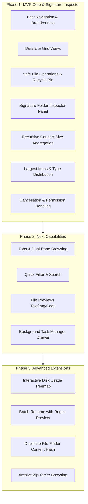
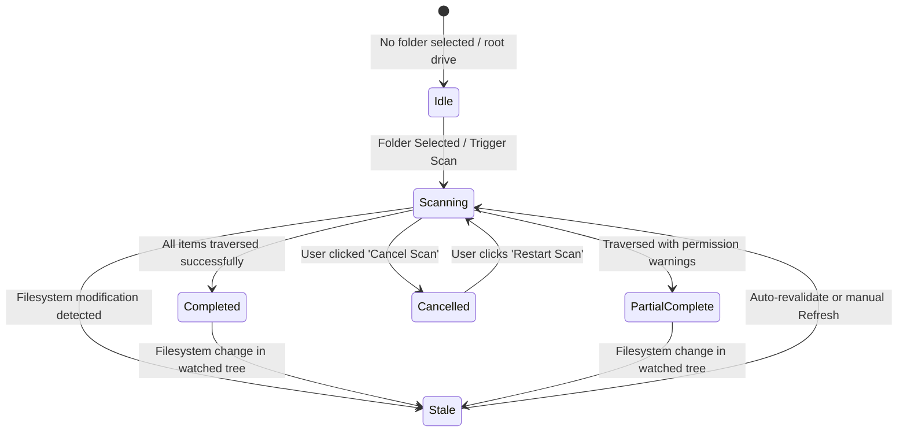

# Product Requirements Document (PRD)
## Advanced File Explorer for Windows

**Document Version:** 1.0.0  
**Status:** Approved for Architecture & Planning  
**Working Title:** Advanced File Explorer  
**Target Platform:** Windows 10 / Windows 11 (x64, ARM64)  
**Author:** File Explorer Engineering Team  
**Reference Document:** `ADVANCED_FILE_EXPLORER_MASTER_BLUEPRINT.md`

---

## 1. Executive Summary & Vision

### 1.1 Product Vision
**Advanced File Explorer** is a high-performance, information-rich, desktop file manager built specifically for Windows power users, software developers, system administrators, and content creators. Standard Windows File Explorer conceals vital filesystem intelligence—most notably folder storage consumption, nested item counts, and file-type distributions—requiring users to click through multiple modal properties windows or turn to fragmented third-party disk-space utilities.

Advanced File Explorer transforms file management by blending instant navigation, safe batch operations, and multi-tab/dual-pane browsing with a dedicated, live-updating **Folder Inspector & Storage Analyzer**. The application upholds four pillars:
1. **Visible System State:** Transparent scanning progress, exact byte counts, clear permission boundaries, and honest indication of complete vs. partial results.
2. **Correctness Before Speed:** Zero fabricated counts or sizes; strict protection against symlink loops, hard-link double counting, and silent scan failures.
3. **Safe File Operations:** Conflict detection, recycle bin preservation, cancellation with rollback where possible, and explicit confirmation before destructive actions.
4. **Responsive Fluidity:** 60 FPS user interface guaranteed through decoupled asynchronous background worker threads, preventing UI lockups even during multi-gigabyte or million-item directory traversals.

### 1.2 Target Users & Personas
- **Power User / Developer (Primary):** Manages code repositories, build artifacts (`node_modules`, `target`, `bin/obj`), large media assets, and virtual environments. Needs to rapidly identify what is consuming disk space, inspect nested folder metrics, and execute fast file operations.
- **System Administrator / IT Specialist (Secondary):** Manages complex folder trees, network shares, and permissions. Requires transparent reporting of unreadable/permission-denied folders without crashing or hanging, plus accurate differentiation between logical size and physical disk allocation.
- **Everyday Windows User (Tertiary):** Seeks an intuitive, clean, modern Fluent-inspired file manager that is more responsive and informative than stock Windows File Explorer without being intimidating.

### 1.3 Key Measurable Goals
| Metric | Target | Measurement Method |
| :--- | :--- | :--- |
| **Directory Navigation Latency** | < 150 ms for folders with up to 5,000 items | Timestamp from click/Enter to DOM render completion |
| **Folder Inspector Scan Throughput** | > 15,000 files/sec on standard NVMe SSD | Time to traverse and aggregate 100,000 files in background worker |
| **UI Responsiveness During Scan** | Main thread frame rate >= 58 FPS | Chrome/Electron DevTools Performance profile during active deep scan |
| **Cancellation Responsiveness** | < 100 ms from user click to scan termination | Timestamp delta between abort signal and worker idle state |
| **Memory Footprint** | < 150 MB baseline; < 350 MB during 500k-item scan | Working set memory observed via Windows Task Manager / Process API |
| **Data Safety & Integrity** | 0 unconfirmed data loss incidents | 100% test pass rate on safe file operations test suite |

---

## 2. User Problems & Key Use Cases

### 2.1 Problems with Standard File Browsers
1. **Folder Size Blindness:** Folders display blank sizes in list views; finding which folder is ballooning storage requires right-clicking each folder individually and waiting for slow properties modal dialogues.
2. **UI Freezing & Sluggishness:** Navigating folders with thousands of items or reading network locations frequently causes the Windows shell to display "(Not Responding)".
3. **Opaque Permission Errors:** Access-denied errors halt entire batch copy/scan operations midway with generic dialogs, leaving users unsure of which files succeeded and which failed.
4. **Lack of Dual-Pane & Effective Workspace Control:** Managing files between source and destination folders requires constantly tiling multiple separate windows.
5. **No Built-in File-Type Distribution:** Determining whether a folder is occupied by videos, build artifacts, raw images, or temp files requires launching external diagnostic utilities.

### 2.2 Core User Journeys
- **Journey 1: Storage Investigation & Triage:** A user with low SSD space launches Advanced File Explorer, selects their user profile or project directory. The Folder Inspector immediately activates in the right pane, progressively streaming total recursive file/folder counts, total size, file-type distribution bar, and a list of the top 5 largest subfolders and files. The user identifies a 40 GB forgotten cache folder and sends it to the Recycle Bin with one click.
- **Journey 2: Dual-Pane Safe Reorganization:** A user working with photography assets opens dual-pane mode (`Ctrl+Shift+E`). Left pane shows the SD card mount; right pane shows the archive directory on a secondary drive. They select 200 raw photos, trigger a move operation, view the background transfer progress bar, and receive clear conflict prompts for existing filenames with "Keep Both", "Overwrite", or "Skip".
- **Journey 3: Deep Scan with Permission Boundaries:** A system administrator scans `C:\ProgramData`. When encountering ACL-restricted folders, the scanner does not fail or halt. The Folder Inspector reports: *"Scan Completed with 3 inaccessible directories"*, listing exact restricted paths and error codes, while accurately presenting complete figures for all accessible subtrees.

---

## 3. Product Scope & Feature Priorities

To deliver reliable, production-grade software without premature overextension, features are prioritized into three phases:

### 3.1 Feature Classification Matrix
- **MVP (Must Have for Initial Release):**
  - High-performance directory listing and navigation (Drives, folders, breadcrumb path bar).
  - Multi-select, sorting (Name, Date Modified, Type, Size), filtering.
  - Safe core file operations (Copy, Cut, Paste, Rename, Delete to Recycle Bin, Permanent Delete with warning).
  - **Folder Inspector Panel:**
    - Selected folder full path and metadata.
    - Direct contents vs. Recursive contents count (Files, Folders).
    - Combined recursive byte size (formatted and exact byte tooltip).
    - Largest files (top 5) and largest subfolders (top 5).
    - File-type category breakdown (Documents, Media, Archives, Code, Other).
    - Empty subfolder count.
    - Non-blocking asynchronous scan engine with live progress counter and elapsed time.
    - Responsive scan cancellation button (< 100 ms stop).
    - Resilient permission handling with explicit unreadable path warnings.
    - Logical file size vs. physical allocation size where supported.
    - Loop detection for symlinks, directory junctions, and reparse points.
- **Next (Targeted for Subsequent Release):**
  - Tabbed browsing (multiple folder tabs per window).
  - Dual-pane browsing (side-by-side active panes with independent navigation).
  - Quick-search filter bar (instant client-side filtering + asynchronous filesystem search).
  - File preview panel (Text, Markdown, Images, Audio, PDF, Code with syntax highlighting).
  - Background Task Queue modal/drawer showing ongoing copy/move jobs with pause/cancel.
- **Later (Post-Core Roadmap):**
  - Disk-space treemap visualization.
  - Multi-file batch rename tool with token replacements and live diff preview.
  - Duplicate file finder (size grouping + hash verification).
  - Direct archive browsing (.zip, .tar.gz, .7z) as virtual directories.
  - Folder comparison and synchronization preview.

---

## 4. Detailed Functional Requirements

### 4.1 Navigation & Breadcrumbs
- `FR-NAV-001`: The system shall display all available local and mapped drives (e.g., `C:\`, `D:\`) with total capacity, free space, and drive volume labels.
- `FR-NAV-002`: The system shall render an interactive breadcrumb address bar reflecting the current active directory path.
- `FR-NAV-003`: Clicking any segment in the breadcrumb bar shall instantly navigate the active view to that ancestor directory.
- `FR-NAV-004`: Clicking on the blank area of the address bar or pressing `Ctrl+L` shall convert the breadcrumbs into an editable text input for direct path entry.
- `FR-NAV-005`: The address bar shall validate manual path input, handling relative paths, environment variables (e.g., `%USERPROFILE%`), trailing slashes, and notifying the user if the path does not exist.
- `FR-NAV-006`: The system shall maintain an in-session navigation history supporting Back (`Alt+Left`), Forward (`Alt+Right`), and Up (`Alt+Up`).
- `FR-NAV-007`: The navigation sidebar shall provide quick-access bookmarks for standard Windows user directories (Home, Desktop, Documents, Downloads, Pictures, Music, Videos).

### 4.2 File Listing & Presentation
- `FR-LIST-001`: The system shall list directory contents with complete metadata: Name, Extension, File Size, Date Modified, Date Created, Attributes (Hidden, Read-Only, System), and File Type description.
- `FR-LIST-002`: The system shall support multiple view modes:
  - Details View (multi-column table with resizable, reorderable columns).
  - Grid / Icon View (large thumbnail/icon cards with filenames).
  - Compact List View (multi-column compact filename layout).
- `FR-LIST-003`: The system shall support column sorting (ascending and descending) for Name, Size, Date Modified, and Type. Folders shall sort before files by default, with a user setting to toggle mixed sorting.
- `FR-LIST-004`: The system shall support single selection, contiguous multi-selection (`Shift+Click`, `Shift+Arrow`), and non-contiguous multi-selection (`Ctrl+Click`, `Space`).
- `FR-LIST-005`: The system shall provide keyboard navigation (Arrow keys, Page Up/Down, Home, End, Enter to open, Backspace to go Up).
- `FR-LIST-006`: The system shall support virtualized list rendering so that directories containing over 50,000 items render smoothly at 60 FPS without DOM degradation.
- `FR-LIST-007`: The system shall visually distinguish hidden items (50% opacity) and provide a toggle (`Ctrl+H`) to show/hide hidden items.

### 4.3 Safe File Operations
- `FR-OPS-001`: The system shall support Copy (`Ctrl+C`), Cut (`Ctrl+X`), and Paste (`Ctrl+V`) for single and multiple files/folders.
- `FR-OPS-002`: The system shall support in-place file and folder renaming (`F2`) with validation against forbidden Windows filename characters (`\ / : * ? " < > |`).
- `FR-OPS-003`: By default, file deletion (`Delete`) shall move items to the Windows Recycle Bin, preserving recovery capability.
- `FR-OPS-004`: Permanent deletion (`Shift+Delete`) shall trigger a mandatory confirmation dialog stating the count of items and total size to be permanently erased.
- `FR-OPS-005`: File operations (Copy, Move) shall execute asynchronously in background worker threads without stalling the user interface.
- `FR-OPS-006`: When a file collision occurs during Copy or Move, the system shall present a Conflict Resolution dialog offering:
  - "Overwrite existing file"
  - "Skip this file"
  - "Keep both (automatically append incremental suffix e.g. `_copy_1`)"
  - "Apply action to all remaining conflicts" checkbox.
- `FR-OPS-007`: File copy and move operations shall support user cancellation at any point, cleanly finalizing the currently copied byte stream and reporting partially completed operations.
- `FR-OPS-008`: The system shall implement a Drag-and-Drop system allowing files/folders to be moved or copied between panes, sidebar bookmarks, or system windows.

### 4.4 Signature Feature: Folder Inspector & Storage Analyzer
*The Folder Inspector is a core signature capability and must receive meticulous engineering rigor.*

- `FR-INSP-001`: When any folder is selected in the file list or navigation tree, the Folder Inspector panel shall display folder identity: Name, Full Path, Creation Date, Last Modified Date, and Attributes.
- `FR-INSP-002`: The Folder Inspector shall differentiate and clearly label:
  - **Direct Contents:** Direct child file count, direct child subfolder count, direct combined file size.
  - **Recursive Contents:** Total descendant file count, total descendant subfolder count, combined recursive size.
- `FR-INSP-003`: Recursive scanning shall run entirely in an isolated background thread (`worker_threads`) communicating progress to the UI via batched IPC messages (max 20 updates/second to avoid event loop saturation).
- `FR-INSP-004`: During an active scan, the Inspector shall display a live scanning state:
  - Animated pulsing indicator.
  - Real-time counter of files and folders enumerated so far.
  - Running byte size accumulation formatted dynamically (B, KB, MB, GB, TB).
  - Elapsed scan duration in seconds (`00:02.4`).
  - An explicit, responsive **"Cancel Scan"** button.
- `FR-INSP-005`: Clicking **"Cancel Scan"** shall stop worker traversal within 100 ms and mark results as **"Partial (Scan Cancelled by User)"**. Partial counts and sizes shall remain visible but be prominently styled with a warning badge so they are never mistaken for complete figures.
- `FR-INSP-006`: The Inspector shall report **Logical File Size** (sum of raw file bytes) and, where available from NTFS/Win32 metadata, **Physical Size on Disk** (accounting for cluster allocation boundaries and compression).
- `FR-INSP-007`: The Inspector shall identify and display the **Top 5 Largest Files** within the inspected subtree, showing relative size bars, file names, and individual paths.
- `FR-INSP-008`: The Inspector shall identify and display the **Top 5 Largest Direct Subfolders** within the inspected folder, showing combined size and percentage of total parent folder storage.
- `FR-INSP-009`: The Inspector shall calculate and display a **File-Type Storage Distribution**:
  - Grouping extensions into standard categories: Documents (`.pdf`, `.docx`, `.txt`, etc.), Media (`.mp4`, `.mp3`, `.png`, `.jpg`, etc.), Archives (`.zip`, `.7z`, `.tar`, etc.), Code (`.ts`, `.js`, `.py`, `.rs`, `.cs`, etc.), Executables (`.exe`, `.dll`, `.msi`), and Other.
  - Rendering a segmented color-coded horizontal proportion bar and percentage breakdown.
- `FR-INSP-010`: The Inspector shall calculate the count of **Empty Subfolders** (directories containing 0 files and 0 subdirectories) within the tree.
- `FR-INSP-011`: **Loop & Symlink Protection:** The scanner shall inspect directory attributes for reparse points / symbolic links / junction points. To avoid infinite cycles and double-counting:
  - Symbolic links and directory junctions shall NOT be recursively traversed by default.
  - Symlink entries shall be recorded as links with their immediate link size, without traversing their target.
  - An optional user toggle ("Follow Symlinks Safely") shall enforce cycle detection via a visited device+inode / unique file identifier set.
- `FR-INSP-012`: **Hard Link Deduplication:** If multiple directory entries point to the same NTFS file ID (hard links), the file size shall be counted exactly once in the combined storage total, with a count of duplicate hard-link references tracked separately.
- `FR-INSP-013`: **Resilient Permission Handling:** If the scanner encounters an inaccessible directory (`EACCES`, `EPERM`, `ERROR_ACCESS_DENIED`):
  - Traversal of other accessible directories shall proceed without interruption.
  - The scan status shall be marked **"Completed with Restrictions"** or **"Partial"**.
  - An expandable "Inaccessible Paths" section shall list each skipped directory, timestamp, and specific system error code.
  - Totals shall never be presented as absolute complete if any path was unreadable.
- `FR-INSP-014`: **Caching & Freshness:** Completed folder scan statistics shall be cached in an in-memory LRU cache keyed by canonical folder path. Cache entries shall record a timestamp. If a filesystem change notification (`fs.watch`) fires inside the inspected tree, the cache entry shall be marked **"Stale"** and prompt the user to refresh or auto-refresh if configured.
- `FR-INSP-015`: **Zero-Mock Verification Guarantee:** In production and normal operation, every metric displayed in the Folder Inspector shall reflect real, verifiable filesystem values. Mock values shall only be permitted in automated visual component unit tests and must be explicitly labeled as fixtures.

### 4.5 Tabs & Dual-Pane Navigation (Phase 2 - Next)
- `FR-PANE-001`: The system shall support opening multiple folder tabs (`Ctrl+T`), closing tabs (`Ctrl+W`), and switching tabs (`Ctrl+Tab`).
- `FR-PANE-002`: The system shall support a Dual-Pane layout (`Ctrl+Shift+E`) presenting two independent file explorers side-by-side with an active pane indicator.
- `FR-PANE-003`: File operations (Copy, Move) in Dual-Pane mode shall automatically default to the inactive pane as the target destination.

### 4.6 Search & Filtering (Phase 2 - Next)
- `FR-SRCH-001`: The system shall provide an instant quick-filter bar (`Ctrl+F`) that filters the current directory listing by name in real-time as the user types.
- `FR-SRCH-002`: The system shall support recursive filesystem search across subdirectories, executing in a background worker with progressive streaming results.
- `FR-SRCH-003`: Advanced search filters shall support file extension filtering (`ext:pdf`), size thresholds (`size:>100MB`), and modification date ranges (`modified:last-7-days`).

### 4.7 File Previews & Metadata (Phase 2 - Next)
- `FR-PREV-001`: The system shall provide a toggleable Preview Panel (`Ctrl+P` or `Space` Quick Look) rendering instant previews for:
  - Text and Code (`.txt`, `.md`, `.json`, `.ts`, `.py`, `.c`, etc.) with line numbers.
  - Images (`.png`, `.jpg`, `.webp`, `.svg`, `.gif`, `.bmp`).
  - Audio/Video metadata and playback controls.
  - PDF document first-page rendering.
- `FR-PREV-002`: File previews shall be sandboxed, read-only, and guarded by file-size safety caps (e.g., text preview truncated at 5 MB to prevent memory spikes).

---

## 5. Non-Functional Requirements (NFRs)

### 5.1 Performance & Responsiveness
- `NFR-001`: **Zero UI Freezes:** All filesystem I/O, folder enumeration, hashing, copying, and recursive scans must run on worker threads or asynchronous APIs. The renderer process main thread must never execute synchronous filesystem calls (`fs.readdirSync`, `fs.statSync`).
- `NFR-002`: **Listing Latency:** Initial listing of 1,000 files in a directory must render in under 100 ms on standard SSD hardware.
- `NFR-003`: **Worker IPC Throttling:** Background scan progress messages must be throttled to 50 ms intervals (max 20 IPC events/sec) to avoid renderer event queue flooding.
- `NFR-004`: **Memory Management:** Memory usage for 100,000 scanned file records must not exceed 80 MB of worker heap. Aggregated metadata must discard individual paths once summarized unless needed for the top-N lists.

### 5.2 Reliability & Fault Tolerance
- `NFR-005`: **Crash Isolation:** An error, permission exception, or filesystem glitch during a background scan must never crash the main application or corrupt existing view state.
- `NFR-006`: **Accurate Representation:** The application must never guess or fabricate numbers. If a scan was aborted at 42% of a directory, it must state "42% completed (cancelled)" and clearly mark figures as partial.

### 5.3 Security & Data Safety
- `NFR-007`: **Path Traversal Protection:** All path arguments passed via IPC or address bar must be normalized and canonicalized, preventing `../` traversal outside permitted user boundaries.
- `NFR-008`: **Recycle Bin Integration:** All regular delete actions must default to Windows IFileOperation / SHFileOperation shell API to route items to the Recycle Bin.
- `NFR-009`: **Privacy First:** The application shall not send telemetry, user filenames, file paths, or directory statistics to any external server or network endpoint. 100% of processing is strictly local.

### 5.4 Accessibility & Windows Integration
- `NFR-010`: Full keyboard navigability across all panels (Sidebar -> List -> Address Bar -> Inspector) with visible focus outlines conforming to WCAG 2.1 AA standards.
- `NFR-011`: Support Windows system dark mode and light mode, switching dynamically based on OS theme changes.
- `NFR-012`: High-DPI display awareness (100%, 125%, 150%, 200%, 250% scaling) without blurry text or misaligned table borders.

---

## 6. Out of Scope

The following capabilities are explicitly out of scope for the initial versions to preserve quality and focus:
1. **Cloud Storage Synchronization:** Custom proprietary sync engines for Google Drive, Dropbox, or OneDrive. (Mounted virtual Windows drive letters will be treated as standard filesystem paths).
2. **Network Protocol Servers:** Running an embedded FTP, SFTP, or WebDAV server inside the app.
3. **Hex Editor / Binary Patcher:** In-depth binary hex editing.
4. **Disk Partitioning or Formatting:** Low-level disk formatting, partition resizing, or volume repair.
5. **Remote Indexing Agent:** Background daemon indexing files while the application is closed.

---

## 7. Assumptions & Dependencies

1. **Host Environment:** Windows 10 (version 1809+) or Windows 11 on 64-bit architecture.
2. **Runtime Foundations:** Node.js 24+ LTS environment, Chromium rendering engine (via Electron desktop wrapper or modern web view container), Windows Win32 Shell API access.
3. **Filesystem Types:** NTFS, ReFS, FAT32, exFAT, and SMB/CIFS network mounts. NTFS features (reparse points, compression, cluster allocation) are utilized where available and gracefully degraded on FAT32/exFAT.

---

## 8. Open Questions & Decision Log

| ID | Topic | Question / Decision Needed | Current Recommendation | Status |
| :--- | :--- | :--- | :--- | :--- |
| **OQ-PRD-01** | Desktop Shell Framework | Use Electron with TypeScript vs. Lightweight WebView2 vs. .NET 10 WinUI? | **Electron 34+ / Node.js 24**: Combines richest cross-process worker architecture, mature multi-tab/dual-pane UI ecosystems, and native access via Node Win32 bindings. | **Proposed** |
| **OQ-PRD-02** | NTFS Physical Allocation | Should physical disk size require elevated administrator rights? | Standard Win32 `GetCompressedFileSizeW` does not require elevation for accessible files; use it for exact physical size. | **Decided** |
| **OQ-PRD-03** | Auto-Scan on Select | Should Folder Inspector auto-scan immediately on single-click or wait for explicit user click? | Quick summary for direct items auto-loads immediately; deep recursive scan starts with a slight debounce (300ms) or an explicit "Scan Tree" button for folders over 10,000 items. | **Decided** |
| **OQ-PRD-04** | Symlink Traversal | Should symlinks ever be followed in recursive size calculations? | Default to **never follow symlinks** to prevent infinite loops and external drive escapes; report symlink count separately. | **Decided** |

---

## 9. Feature Status & Verification Ledger

| Requirement ID | Feature Description | Priority | Implemented? | Verified? | Verification Notes |
| :--- | :--- | :--- | :--- | :--- | :--- |
| `FR-NAV-001` - `007` | Drive & Breadcrumb Navigation | MVP | Planned | Not run | Pending Phase 3 implementation |
| `FR-LIST-001` - `007` | Details, Grid Views & Sorting | MVP | Planned | Not run | Pending Phase 3 implementation |
| `FR-OPS-001` - `008` | Safe File Operations & Recycle Bin | MVP | Planned | Not run | Pending Phase 4 implementation |
| `FR-INSP-001` - `015` | Signature Folder Inspector & Storage Scan | MVP | Planned | Not run | Pending Phase 5 implementation |
| `FR-PANE-001` - `003` | Tabs & Dual Pane Navigation | Next | Planned | Not run | Pending Phase 6 implementation |
| `FR-SRCH-001` - `003` | Instant Filter & Recursive Search | Next | Planned | Not run | Pending Phase 7 implementation |
| `FR-PREV-001` - `002` | Sandboxed File Previews | Next | Planned | Not run | Pending Phase 7 implementation |
| `FR-VIZ-001` | Disk Storage Treemap | Later | Planned | Not run | Future Phase 8 evaluation |
